# Assignment 01: Git, Gitea, GitHub, Git LFS, and GitHub Pages

| | |
|---|---|
| **Name** | Ayesha Kanwal |
| **Registration No** | fa24b1-se-077 |
| **Course** | Cloud Computing (BSE-410) |
| **University** | Fatima Jinnah Women University, Department of Software Engineering |
| **Submitted To** | Sir Waqas |
| **Date** | October 2026 |

---

## Task 1: Install Gitea and Push a Repository from the Ubuntu Server

I installed Docker and Docker Compose on my Ubuntu server, cloned the instructor's Gitea setup repository, and started Gitea with PostgreSQL using the supplied `compose.yaml` without changing any settings. I then created a separate local repository, committed a `README.md` with my name and registration number, and pushed it to Gitea over the local loopback address using a personal access token entered only at the password prompt.

### Step 1.1: Install and Run Gitea

```bash
git --version
docker --version
docker compose version
git clone https://github.com/WaqasSaleem97/Gitea.git
cd Gitea
docker compose up -d
docker compose ps
curl -sS -o /dev/null -w "Gitea HTTP status: %{http_code}\n" http://127.0.0.1:3000/
```

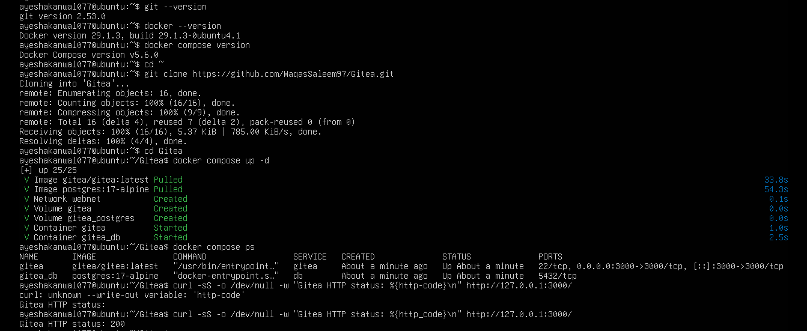

*Gitea and PostgreSQL running, HTTP status 200*

### Step 1.2: Create and Push the Initial Repository

```bash
mkdir Assignment01 && cd Assignment01
git init
git branch -M main
git add README.md
git commit -m "Add student information"
git remote add gitea http://ayeshakanwal077@127.0.0.1:3000/ayeshakanwal077/Assignment01.git
git remote -v
git push -u gitea main
```

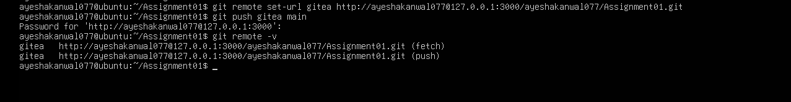

*Gitea remote and successful push*

### Step 1.3: Verify the Gitea Repository

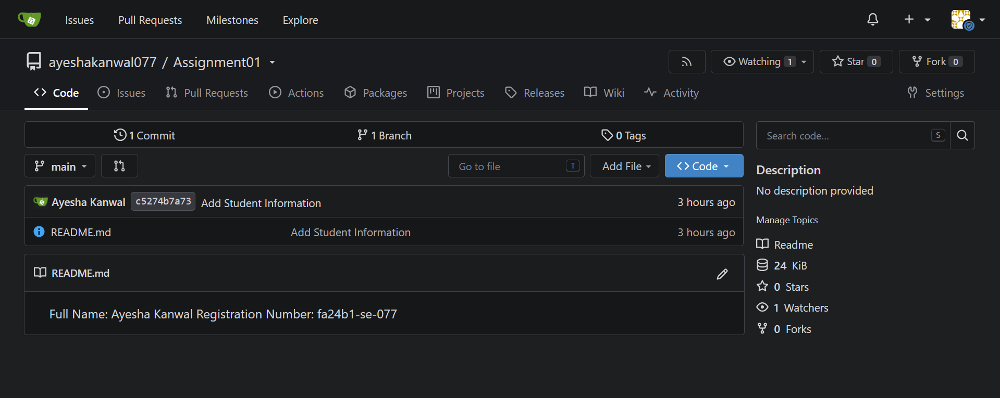

*Assignment01 repository in Gitea*

---

## Task 2: Push the Same Repository to GitHub

I created an empty public GitHub repository named `Assignment01`, added it as a second remote called `github` to the same local repository, and pushed the `main` branch to it.

### Step 2.1: Add the GitHub Remote

```bash
cd ~/Assignment01
git remote add github https://github.com/ayeshakanwal077/Assignment01.git
git remote -v
```

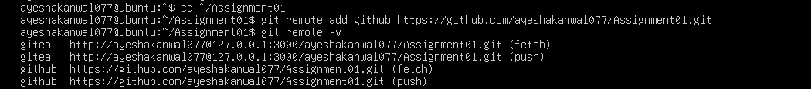

*Both gitea and github remotes*

### Step 2.2: Push to GitHub

```bash
git push -u github main
```

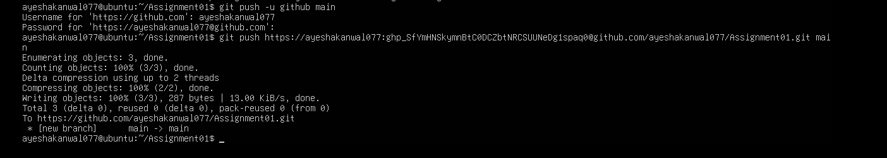

*Successful push to GitHub (credentials hidden)*

### Step 2.3: Verify the GitHub Repository

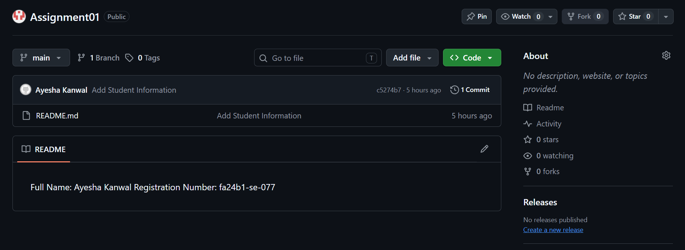

*Assignment01 repository on GitHub*

---

## Task 3: Track Three Large Files with Git LFS

I initialised Git LFS, tracked all `*.bin` files, created three files larger than 100 MiB, verified them with `git lfs ls-files --size`, and pushed them to GitHub.

### Step 3.1: Configure Git LFS

```bash
cd ~/Assignment01
git lfs install
git lfs version
git lfs track "*.bin"
cat .gitattributes
```

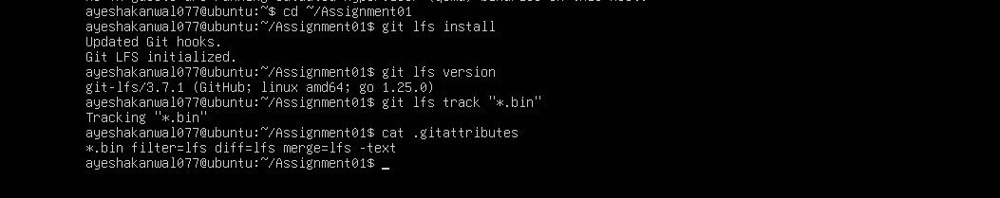

*Git LFS setup and tracking rule*

### Step 3.2: Create and Verify Three LFS Files

```bash
truncate -s 101M large-file-1.bin
truncate -s 102M large-file-2.bin
truncate -s 103M large-file-3.bin
git add .gitattributes large-file-1.bin large-file-2.bin large-file-3.bin
git lfs ls-files --size
```

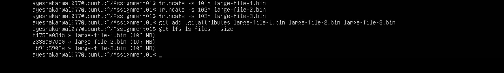

*Three files tracked by Git LFS*

### Step 3.3: Commit and Push the LFS Files

```bash
git commit -m "Add three files using Git LFS"
git push github main
```

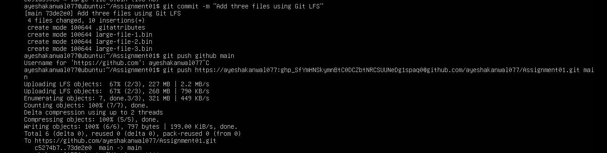

*LFS upload and push to GitHub (credentials hidden)*

---

## Task 4: Create a Portfolio with GitHub Pages

I created a public repository named `ayeshakanwal077.github.io` with `index.html` and `styles.css`, containing About Me, Education, Skills, and Projects sections, and published it with GitHub Pages (Deploy from a branch: `main`, `/ (root)`).

### Step 4.1: Portfolio Repository

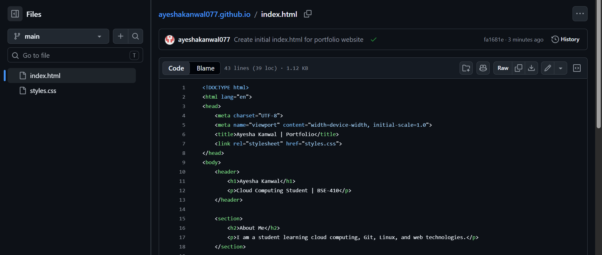

*Portfolio repository*

### Step 4.2: Publish with GitHub Pages

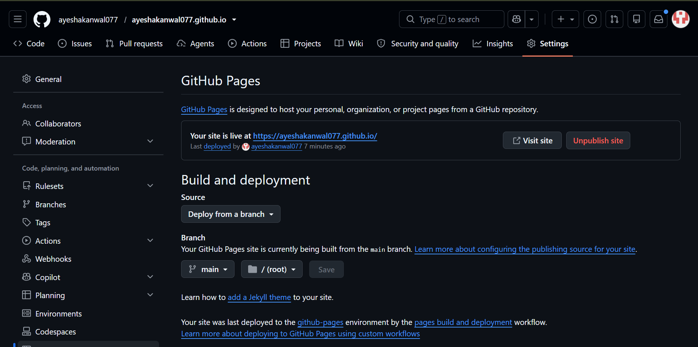

*GitHub Pages deployment*

### Step 4.3: Verify the Live Portfolio

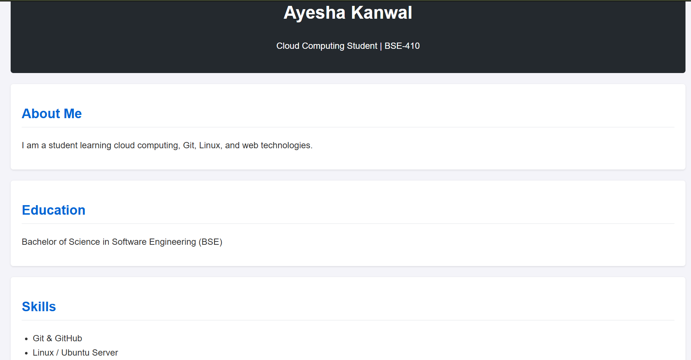

*Live portfolio*

---

## Repositories & Portfolio Links

- **CC Repository:** https://github.com/ayeshakanwal077/CC
- **Assignment01 Repository:** https://github.com/ayeshakanwal077/Assignment01
- **Live Portfolio:** https://ayeshakanwal077.github.io/
